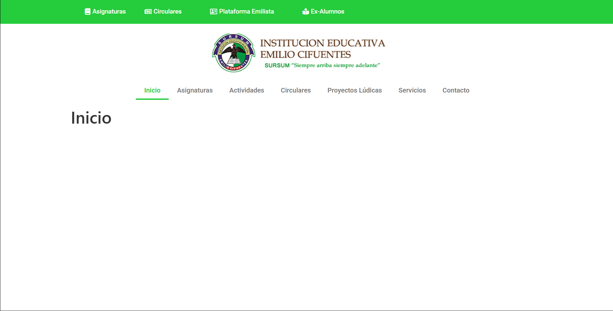
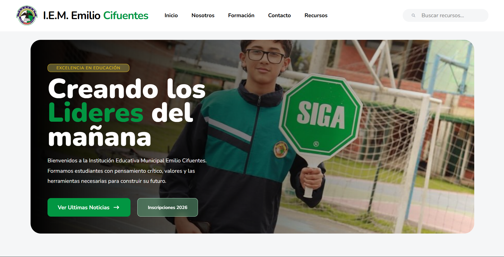
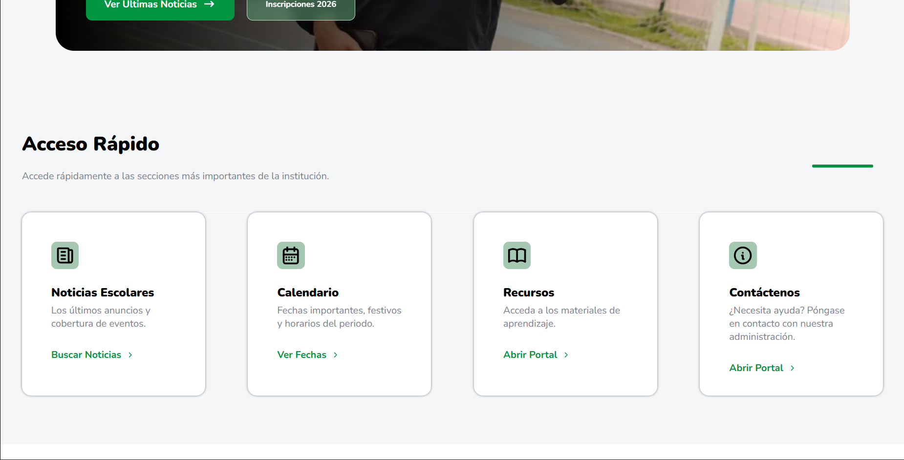
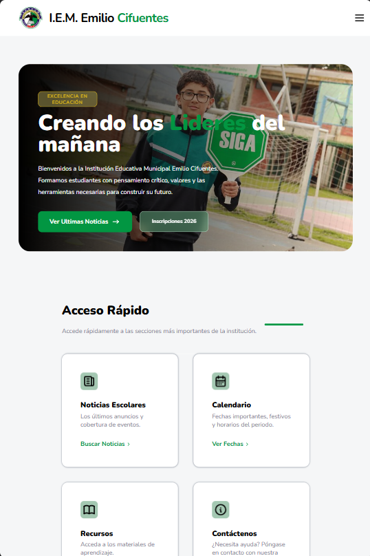
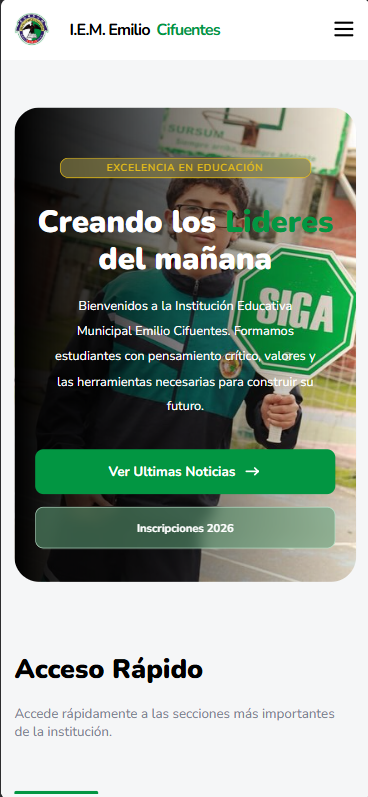
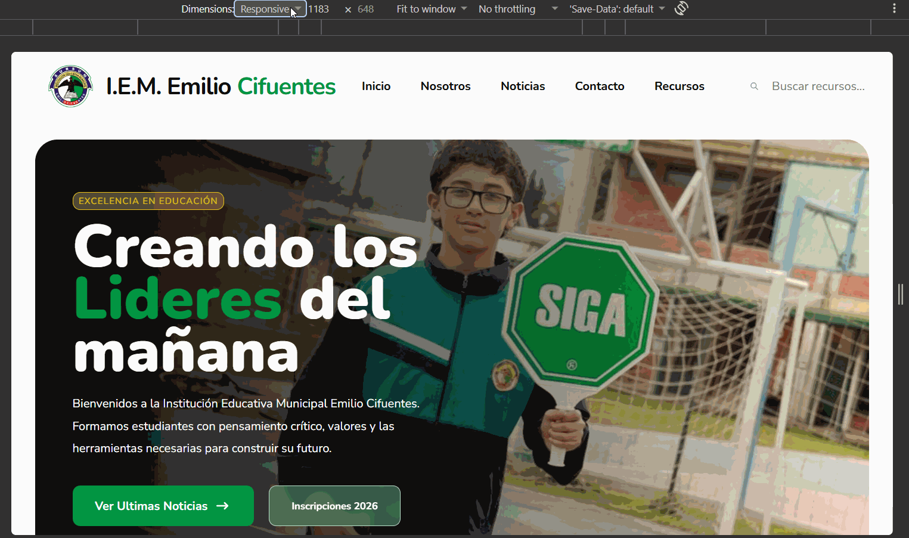

<div align="center">


<a href="https://g4lvan.github.io/demo_page_colegio.github.io/" target="_blank" rel="noopener noreferrer">
  
</a>

# Rediseño Web — Institución Educativa Municipal Emilio Cifuentes

Propuesta de rediseño del sitio web institucional, enfocada en usabilidad, diseño responsive y estructura de contenido.

**[Ver demo en línea](https://g4lvan.github.io/demo_page_colegio.github.io/)**

</div>

---

## Tabla de contenidos

1. [Resumen](#resumen)
2. [Contexto y problemática](#contexto-y-problemática)
3. [Objetivos](#objetivos)
4. [Solución propuesta](#solución-propuesta)
5. [Vista previa](#vista-previa)
6. [Stack tecnológico](#stack-tecnológico)
7. [Estructura del repositorio](#estructura-del-repositorio)
8. [Ejecución local](#ejecución-local)
9. [Convenciones del proyecto](#convenciones-del-proyecto)
10. [Estado y roadmap](#estado-y-roadmap)
11. [Limitaciones conocidas](#limitaciones-conocidas)
12. [Autor](#autor)
13. [Licencia](#licencia)

---

## Resumen

Este proyecto rediseña la presencia web de la **Institución Educativa Municipal Emilio Cifuentes** (Facatativá, Cundinamarca, Colombia). Parte de un análisis del sitio actual y propone una interfaz moderna, adaptable a distintos dispositivos y con una organización de contenido más clara.

Actualmente se encuentra en fase **MVP**: HTML5 y CSS3 puros, sin frameworks, como base para evolucionar de forma incremental.

## Contexto y problemática

El análisis del sitio original identificó los siguientes problemas:

| Área | Problema detectado |
|------|--------------------|
| Diseño visual | Estética desactualizada, basada en plantillas tradicionales |
| Jerarquía | Exceso de texto sin estructura; contenido difícil de escanear |
| Navegación | Poco intuitiva |
| Móvil | Adaptación limitada a dispositivos móviles |
| Contenido | Secciones incompletas |
| Rendimiento | Animaciones poco optimizadas y bajo rendimiento general |

## Objetivos

- Modernizar la interfaz del sitio institucional.
- Mejorar la experiencia de usuario (UX).
- Implementar un diseño completamente responsive.
- Reorganizar la estructura de la información.
- Aplicar HTML semántico y buenas prácticas de accesibilidad.
- Optimizar rendimiento y tiempos de carga.

## Solución propuesta

- Interfaz limpia con jerarquía visual clara.
- Navegación simplificada.
- Layout responsive construido con **Flexbox** y **Grid**.
- Estructura HTML semántica y escalable.
- Base preparada para incorporar contenido dinámico en versiones futuras.

## Vista previa

### Comparación

| Sitio original | Rediseño |
|:--------------:|:--------:|
|  |  |

### Escritorio




### Tablet y móvil

| Tablet | Móvil |
|:------:|:-----:|
|  |  |

### Comportamiento responsive



## Stack tecnológico

**Actual**


**Evaluado para versiones futuras**


- JavaScript para interactividad (menú móvil, buscador).
- CMS para gestión de contenido.
- Conexión del calendario a datos dinámicos (la cuadrícula ya existe en `pages/calendario.html`).

## Estructura del repositorio

```
demo_page_colegio.github.io/
├── index.html      # Página principal
├── 404.html        # Página 404 personalizada para GitHub Pages
├── pages/          # Subpáginas (nosotros, noticias, contacto, recursos, calendario)
├── css/            # Hojas de estilo (una general + una por subpágina)
├── js/             # Scripts cargados como módulos desde js/main.js
├── data/           # Datos de noticias (JSON)
├── docs/           # Estándares de commits y comentarios
├── assets/         # Imágenes, logos, íconos y fuentes
├── preview/        # Capturas y GIFs de demostración
└── README.md
```

## Ejecución local

No requiere instalación ni dependencias.

```bash
git clone https://github.com/g4lvan/demo_page_colegio.github.io.git
cd demo_page_colegio.github.io
```

Abre `index.html` directamente en el navegador. Para un entorno más cercano a producción, usa un servidor local (por ejemplo, la extensión *Live Server* de VS Code).

## Convenciones del proyecto

El repositorio sigue estándares documentados para mantener consistencia:

- **Commits:** formato `<tipo>(<alcance>): <descripción>` en español, imperativo y minúsculas. Ver [`COMMIT_STANDARD.md`](COMMIT_STANDARD.md).
- **Comentarios de código:** cinco tipos con la extensión *Better Comments*. Ver [`COMMENTING_STANDARD.md`](COMMENTING_STANDARD.md).

## Estado y roadmap

| Fase | Alcance | Estado |
|------|---------|--------|
| **MVP** | Rediseño visual, layout responsive, organización de secciones | En curso |
| **v1.0** | Optimización de rendimiento, mejoras visuales, animaciones más fluidas | Planeado |
| **v2.0** | Noticias dinámicas, fuente de datos del calendario, sistema de documentos | Planeado |
| **v3.0** | Panel de administración (CMS), gestión de contenido, posible sistema de usuarios | Planeado |

## Limitaciones conocidas

Este es un demo en fase MVP. Aspectos pendientes:

- El contenido es estático (noticias y textos escritos directamente en el HTML).
- El calendario (`pages/calendario.html`) es estático: un evento real (ceremonia de grado 11) y tres ficticios que demuestran los tipos de etiqueta; la fuente de datos se conectará en v2.0.
- El buscador es solo visual, sin lógica conectada.
- Algunos enlaces de navegación están pendientes de sus páginas.
- No se han realizado auditorías formales de rendimiento ni accesibilidad.

## Autor

**Juan Andres Gallego Vanegas**
Proyecto desarrollado como iniciativa personal para mejorar la presencia digital de la institución.

[](https://github.com/g4lvan)
[](https://www.instagram.com/g4lvan_)

## Licencia

Distribuido bajo licencia **MIT**.